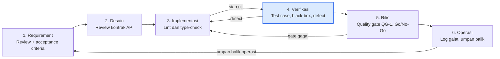

# 02 — QA Lifecycle dan Feedback Loop (P02)

Praktikum Quality Assurance · Aplikasi: **Lernova Web v0.1.0**
Kelompok: `Kelompok 4` · 
Anggota: ` 1. Muhammad Adzkia Madani / 23076012
           2. Alim Kurniadi/ 23076003
           3. Muhammad Hariadi / 23076043
           4. Zekia Rahmaddiano / 23076056 `

> Ambang batas pada quality gate adalah **usulan kelompok** dan dapat disesuaikan pada P04.

## 1. Alur SDLC dan Posisi QA

Lernova dikembangkan secara iteratif: fitur dibangun per halaman atau modul (autentikasi, tes, hasil, dashboard per peran), lalu dirilis ke Firebase (`firebase.json`, `.firebaserc`). Model yang dipakai adalah **SDLC iteratif/agile dengan umpan balik pada setiap iterasi**. QA tidak menjadi tahap terakhir, tetapi hadir di setiap tahap.

| Tahap SDLC | Kegiatan pengembangan | Aktivitas QA pada tahap ini | Artefak QA |
|---|---|---|---|
| 1. Requirement | Menetapkan kebutuhan siswa, guru, admin | Review requirement, tulis acceptance criteria (Given-When-Then), analisis risiko | P03: Requirement dan Risk Register |
| 2. Desain | Rancang alur tes, skema Firestore, kontrak API | Review desain dan kontrak API (otorisasi, validasi), threat check singkat | Catatan review desain |
| 3. Implementasi | Kode Next.js/TypeScript | Lint, type-check, code review checklist | Hasil lint dan review |
| 4. Verifikasi | Pengujian | Rancang dan jalankan test case, black-box, catat defect | P05, P06, P07 |
| 5. Rilis | Deploy ke Firebase | Evaluasi quality gate, keputusan Go/No-Go | P08: Laporan audit |
| 6. Operasi | Penggunaan oleh pengguna | Pantau log galat, kumpulkan umpan balik | Sumber evidence shift-right |

Tiga panah balik menunjukkan jalur umpan balik: defect kembali ke implementasi, gate gagal kembali ke implementasi, dan umpan balik operasi kembali ke requirement. Kotak berwarna adalah tahap tempat test case dieksekusi (QC).

## 2. Aktivitas Shift-Left

Shift-left berarti memindahkan pencegahan cacat ke tahap yang lebih awal. Tiga aktivitas dipilih (minimal dua diwajibkan).

| No | Aktivitas shift-left | Tahap | Cacat yang dicegah | Hubungan dengan P01 |
|---|---|---|---|---|
| SL-1 | **Review requirement dan acceptance criteria sebelum coding.** Aturan tie-break gaya dominan, rentang persentase 0-100, dan syarat semua soal terjawab ditulis eksplisit. | Requirement | Ambiguitas aturan bisnis yang menimbulkan hasil keliru | PM-01 |
| SL-2 | **Review kontrak API dengan checklist keamanan.** Setiap endpoint wajib: autentikasi, otorisasi per peran, validasi rentang dan tipe di server, tidak mengirim kunci jawaban ke klien. | Desain | Endpoint tanpa otorisasi dan kebocoran kunci jawaban | PM-02, PM-03 |
| SL-3 | **Pemeriksaan statis otomatis** (`npm run lint`, type-check TypeScript, `next build`) dijalankan sebelum merge. Daftar endpoint debug diperiksa agar tidak ikut build produksi. | Implementasi | Kesalahan kode dasar, kode debug tertinggal | PM-05 |

## 3. Sumber Evidence Shift-Right

Shift-right berarti mengumpulkan bukti kualitas dari lingkungan yang berjalan atau dari pengguna.

| No | Sumber evidence | Isi bukti | Dipakai untuk |
|---|---|---|---|
| SR-1 | **Log galat aplikasi.** Repo sudah memiliki `lib/errorLogger.ts` dan panduan `ERROR_LOGGING_GUIDE.md`. | Frekuensi dan jenis galat saat login, simpan hasil tes, atau muat soal | Mendeteksi kegagalan submit hasil dan galat muat soal |
| SR-2 | **Data hasil di Firestore** (koleksi `hasilTes`). | Pola abnormal, misalnya persentase di luar 0-100, hasil ganda, atau hasil tanpa pengguna yang sah | Membuktikan atau membantah PM-02 dan PM-04 |
| SR-3 | **Umpan balik guru dan siswa** (kuesioner singkat atau catatan). | Keluhan kebingungan pesan galat atau hasil yang dirasa tidak sesuai | Mengukur usability dan kepercayaan terhadap hasil |

SR-1 hingga SR-3 merupakan **rencana pengumpulan**. Pada praktikum ini, evidence yang pasti tersedia adalah log konsol dan data Firestore dummy dari lingkungan uji.

## 4. Quality Gate

**Quality Gate QG-1: Kelayakan rilis hasil uji (sebelum keputusan Go/No-Go di P08).**

| No | Kriteria gate | Ambang batas (usulan) | Cara pembuktian |
|---|---|---|---|
| 1 | Lint dan build | `npm run lint` tanpa error, `next build` berhasil | Log terminal |
| 2 | Eksekusi test case | 100% test case terjadwal telah dieksekusi | `test-cases/05_Test_Cases.csv` |
| 3 | Pass rate | 100% test case prioritas tinggi lulus, minimal 90% keseluruhan | Rekap hasil |
| 4 | Defect terbuka | 0 defect Critical, 0 defect High tanpa mitigasi tertulis | `docs/07_Defect_Report_RCA.md` |
| 5 | Keamanan dasar | Endpoint `/api/seed`, `/api/test-results`, dan endpoint debug tidak dapat dipakai tanpa otorisasi | Hasil uji negatif dan screenshot |
| 6 | Keterlacakan | Seluruh requirement prioritas memiliki minimal satu test case di RTM | `test-cases/05_RTM.csv` |

**Aturan keputusan.** Semua kriteria terpenuhi: *Go*. Gagal hanya pada kriteria bermitigasi (mis. defect Medium): *Conditional Go*. Ada defect Critical atau kriteria 5 gagal: *No-Go*.

## 5. Alur Umpan Balik (Feedback Loop)

| Jalur | Pemicu | Alur | Penerima |
|---|---|---|---|
| **Loop pengembangan** | Test case gagal saat eksekusi | Catat defect → triage (severity dan prioritas) → analisis akar masalah (5-Why) → perbaikan → retest → perbarui RTM | Pengembang, QA |
| **Loop gate** | Kriteria quality gate tidak terpenuhi | Laporan gate → keputusan Conditional Go/No-Go → perbaikan atau mitigasi → evaluasi ulang | Seluruh tim |
| **Loop operasi** | Galat di log atau keluhan pengguna | Catat sebagai masukan → review requirement → tambahkan risiko dan test case baru | Pemilik produk, QA |

Setiap loop berakhir pada pembaruan artefak (requirement, risk register, test case, RTM) agar pelajaran tidak hilang.

## 6. Kesimpulan Tahap 2

- SDLC iteratif dengan QA pada setiap tahap, dari requirement hingga operasi.
- Tiga aktivitas shift-left (SL-1 sampai SL-3) langsung menjawab PM-01, PM-02, PM-03, dan PM-05 dari P01.
- Tiga sumber evidence shift-right (SR-1 sampai SR-3) disiapkan, dengan log galat yang sudah tersedia di repo.
- QG-1 memuat enam kriteria terukur dan aturan Go/Conditional Go/No-Go.
- Keterlacakan: aturan gate akan dirinci pada P04 dan dievaluasi pada P08.
