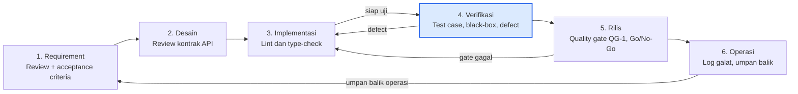

# 02 — QA Lifecycle dan Feedback Loop (P02), Versi Parafrase

Praktikum Quality Assurance · Aplikasi: **Lernova Web v0.1.0**
Kelompok: `Kelompok 4`
Anggota:
1. Muhammad Adzkia Madani / 23076012
2. Alim Kurniadi / 23076003
3. Muhammad Hariadi / 23076043
4. Zekia Rahmaddiano / 23076056

> Nilai ambang pada quality gate merupakan **usulan kelompok** dan masih dapat diubah pada P04.

## 1. Alur SDLC dan Peran QA

Pengembangan Lernova berjalan secara iteratif. Fitur dikerjakan per halaman atau modul (autentikasi, tes, hasil, dan dashboard tiap peran), kemudian dirilis ke Firebase melalui `firebase.json` dan `.firebaserc`. Model yang digunakan adalah **SDLC iteratif/agile dengan umpan balik di setiap iterasi**. QA tidak ditempatkan sebagai tahap penutup saja, melainkan terlibat sejak awal hingga akhir.

| Tahap SDLC | Kegiatan pengembangan | Peran QA pada tahap ini | Artefak QA |
|---|---|---|---|
| 1. Requirement | Menyusun kebutuhan siswa, guru, dan admin | Meninjau requirement, menulis acceptance criteria (Given-When-Then), menganalisis risiko | P03: Requirement dan Risk Register |
| 2. Desain | Merancang alur tes, skema Firestore, dan kontrak API | Meninjau desain dan kontrak API (otorisasi, validasi) serta melakukan threat check singkat | Catatan review desain |
| 3. Implementasi | Menulis kode Next.js/TypeScript | Menjalankan lint, type-check, dan code review berbasis checklist | Hasil lint dan review |
| 4. Verifikasi | Pengujian perangkat lunak | Menyusun dan mengeksekusi test case, pengujian black-box, serta pencatatan defect | P05, P06, P07 |
| 5. Rilis | Deploy ke Firebase | Menilai quality gate dan memutuskan Go/No-Go | P08: Laporan audit |
| 6. Operasi | Aplikasi dipakai pengguna | Memantau log galat dan menghimpun umpan balik | Sumber evidence shift-right |

Terdapat tiga panah balik sebagai jalur umpan balik: defect kembali ke implementasi, kegagalan gate kembali ke implementasi, dan umpan balik operasi kembali ke requirement. Kotak berwarna menandai tahap eksekusi test case (QC).

## 2. Kegiatan Shift-Left

Shift-left artinya memajukan upaya pencegahan cacat ke tahap-tahap awal. Kami memilih tiga kegiatan (minimal dua yang diwajibkan).

| No | Kegiatan shift-left | Tahap | Cacat yang dicegah | Kaitan dengan P01 |
|---|---|---|---|---|
| SL-1 | **Meninjau requirement dan acceptance criteria sebelum pengodean.** Aturan tie-break gaya dominan, rentang persentase 0-100, dan ketentuan bahwa semua soal harus dijawab dituliskan secara eksplisit. | Requirement | Aturan bisnis yang ambigu sehingga menghasilkan keluaran keliru | PM-01 |
| SL-2 | **Meninjau kontrak API menggunakan checklist keamanan.** Tiap endpoint harus memiliki autentikasi, otorisasi berdasarkan peran, validasi rentang dan tipe data di sisi server, serta tidak mengirim kunci jawaban ke klien. | Desain | Endpoint tanpa otorisasi dan bocornya kunci jawaban | PM-02, PM-03 |
| SL-3 | **Pemeriksaan statis otomatis** (`npm run lint`, type-check TypeScript, `next build`) dijalankan sebelum merge. Daftar endpoint debug juga dicek agar tidak terbawa ke build produksi. | Implementasi | Kesalahan dasar pada kode dan sisa kode debug | PM-05 |

## 3. Sumber Evidence Shift-Right

Shift-right berarti mengumpulkan bukti kualitas dari lingkungan yang sedang berjalan atau langsung dari pengguna.

| No | Sumber evidence | Isi bukti | Kegunaan |
|---|---|---|---|
| SR-1 | **Log galat aplikasi.** Repositori telah menyediakan `lib/errorLogger.ts` dan panduan `ERROR_LOGGING_GUIDE.md`. | Seberapa sering dan jenis galat apa yang muncul saat login, penyimpanan hasil tes, atau pemuatan soal | Mendeteksi kegagalan pengiriman hasil dan galat saat memuat soal |
| SR-2 | **Data hasil di Firestore** (koleksi `hasilTes`). | Pola janggal, seperti persentase di luar 0-100, hasil ganda, atau hasil tanpa pengguna yang sah | Membuktikan atau menyanggah PM-02 dan PM-04 |
| SR-3 | **Umpan balik guru dan siswa** (kuesioner singkat atau catatan). | Keluhan mengenai pesan galat yang membingungkan atau hasil yang dianggap tidak sesuai | Mengukur usability dan tingkat kepercayaan terhadap hasil |

SR-1 sampai SR-3 adalah **rencana pengumpulan data**. Dalam praktikum ini, evidence yang pasti tersedia hanyalah log konsol dan data dummy Firestore dari lingkungan uji.

## 4. Quality Gate

**Quality Gate QG-1: Kelayakan rilis berdasarkan hasil uji (sebelum keputusan Go/No-Go di P08).**

| No | Kriteria gate | Ambang batas (usulan) | Cara pembuktian |
|---|---|---|---|
| 1 | Lint dan build | `npm run lint` bebas error dan `next build` sukses | Log terminal |
| 2 | Eksekusi test case | Seluruh (100%) test case yang dijadwalkan sudah dieksekusi | `test-cases/05_Test_Cases.csv` |
| 3 | Pass rate | Semua test case prioritas tinggi lulus (100%), dan minimal 90% lulus secara keseluruhan | Rekapitulasi hasil |
| 4 | Defect terbuka | Tidak ada defect Critical, dan tidak ada defect High tanpa mitigasi tertulis | `docs/07_Defect_Report_RCA.md` |
| 5 | Keamanan dasar | Endpoint `/api/seed`, `/api/test-results`, dan endpoint debug tidak bisa diakses tanpa otorisasi | Hasil uji negatif dan screenshot |
| 6 | Keterlacakan | Setiap requirement prioritas terhubung ke minimal satu test case dalam RTM | `test-cases/05_RTM.csv` |

**Aturan keputusan.** Jika semua kriteria terpenuhi: *Go*. Jika hanya kriteria yang dapat dimitigasi yang tidak terpenuhi (misalnya defect Medium): *Conditional Go*. Jika ada defect Critical atau kriteria 5 tidak terpenuhi: *No-Go*.

## 5. Alur Umpan Balik (Feedback Loop)

| Jalur | Pemicu | Alur | Penerima |
|---|---|---|---|
| **Loop pengembangan** | Test case gagal saat dieksekusi | Catat defect → triage (severity dan prioritas) → analisis akar masalah (5-Why) → perbaikan → retest → perbarui RTM | Pengembang, QA |
| **Loop gate** | Kriteria quality gate tidak terpenuhi | Laporan gate → keputusan Conditional Go/No-Go → perbaikan atau mitigasi → evaluasi ulang | Seluruh anggota tim |
| **Loop operasi** | Galat pada log atau keluhan dari pengguna | Catat sebagai masukan → tinjau ulang requirement → tambahkan risiko dan test case baru | Pemilik produk, QA |

Setiap loop ditutup dengan memperbarui artefak terkait (requirement, risk register, test case, RTM) supaya pelajaran yang diperoleh tidak hilang.

## 6. Kesimpulan Tahap 2

- Digunakan SDLC iteratif dengan keterlibatan QA di setiap tahap, mulai dari requirement sampai operasi.
- Tiga kegiatan shift-left (SL-1 hingga SL-3) secara langsung menanggapi PM-01, PM-02, PM-03, dan PM-05 dari P01.
- Tiga sumber evidence shift-right (SR-1 hingga SR-3) telah disiapkan, dengan log galat sebagai sumber yang sudah ada di repositori.
- QG-1 berisi enam kriteria terukur beserta aturan keputusan Go/Conditional Go/No-Go.
- Keterlacakan: aturan gate akan dirinci pada P04 dan dievaluasi pada P08.
