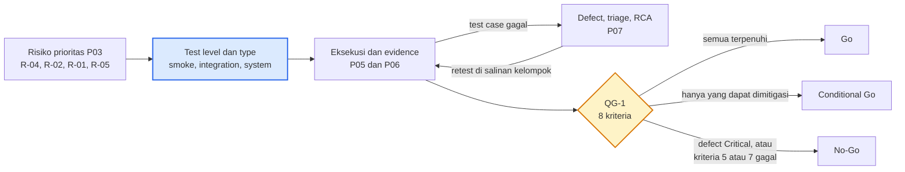

# 04 — Test Strategy dan Test Plan (P04)

Praktikum Quality Assurance · Aplikasi: **Lernova Web v0.1.0**
Kelompok: `Kelompok 4`
Anggota:
1. Muhammad Adzkia Madani / 23076012
2. Alim Kurniadi / 23076003
3. Muhammad Hariadi / 23076043
4. Zekia Rahmaddiano / 23076056

> Versi diuji: 0.1.0 (folder proyek bukan repository git; penanda versi: arsip `Lernova_Web.zip`, diterima 7 November 2026). Dokumen ini melanjutkan P01–P03 (`docs/01`–`03`): ambang quality gate QG-1 pada P02 dirinci di sini, dan risiko prioritas dari P03 (R-04, R-02, R-01, serta R-05) menentukan test level dan type.

---

## 1. Tujuan, Scope, In-Scope dan Out-of-Scope

### 1.1 Tujuan pengujian
1. Memastikan alur utama berjalan sesuai requirement: daftar → login → tes gaya belajar → hasil.
2. Menguji **tiga risiko prioritas** (R-04, R-02, R-01) dan risiko fungsional inti (R-05) dengan bukti yang dapat diperiksa.
3. Menghasilkan keputusan kualitas (Go / Conditional Go / No-Go) yang berbasis evidence pada Tahap 8.

### 1.2 Scope

| In-scope | Alasan (rujukan risiko/requirement) |
|---|---|
| Registrasi dan login (validasi input, pesan error, pengalihan role) | REQ-01, REQ-02 |
| Pembatasan akses halaman `/tes` dan dashboard berdasarkan role | REQ-03, R-01 |
| Tes 15 soal: wajib lengkap, pengacakan opsi, perhitungan persentase, gaya dominan, kasus seri | REQ-04, REQ-05, R-05 |
| Penyimpanan dan tampilan hasil di `/hasil`, urutan riwayat | REQ-06 |
| API `/api/test-results` (POST/GET), termasuk uji negatif tanpa autentikasi | REQ-07, R-02 |
| Endpoint `/api/seed` dan `/api/debug/*` (keterbukaan akses) | REQ-08, R-03, R-06 |
| Build dan lint aplikasi (`npm run build`, `npm run lint`) | R-04 |
| Verifikasi security rules Firestore rancangan (`lib/firestore-schema.md`) pada project uji milik kelompok | R-01, R-06, R-07 |

| Out-of-scope | Alasan |
|---|---|
| Performance/load testing dan stress test | Di luar cakupan praktikum; tidak ada kebutuhan kinerja terukur pada requirement. |
| Pengujian keamanan destruktif atau terhadap infrastruktur Firebase produksi | Dilarang ketentuan etika praktikum; hanya project uji dengan data dummy. |
| Uji kompatibilitas luas (banyak perangkat/versi browser) | Dibatasi dua browser; risiko tidak diprioritaskan. |
| Konten dan validitas pedagogis rekomendasi belajar | Bukan kualitas perangkat lunak; butuh ahli bidang. |
| Halaman admin lanjutan (kelola kelas, pengguna, pertanyaan) dan halaman analisis guru | Tidak termasuk requirement REQ-01…REQ-09; dicatat sebagai **blind spot** untuk Tahap 8. |
| Pengujian internal pustaka pihak ketiga (Next.js, Firebase SDK) | Dianggap andal; hanya integrasinya yang diuji. |

---

## 2. Test Level dan Test Type Berdasarkan Prioritas Risiko

| Prioritas | Risiko | Test level | Test type | Teknik / pendekatan | Kasus uji yang diharapkan |
|---|---|---|---|---|---|
| 1 | **R-04** build gagal (skor 25, sudah terbukti) | Build verification (smoke) | Non-fungsional: build/lint | Jalankan `npm ci`, `npm run build`, `npm run lint`; catat output. | Build lulus tanpa *module not found*. |
| 2 | **R-02** API tanpa autentikasi dan validasi (16) | Integration (API ↔ Firestore) | Security (access control), negatif, boundary | Panggil `POST`/`GET /api/test-results` dengan `curl` tanpa token, dengan `userId` milik pengguna lain, dan dengan persentase di luar 0–100. | AC-07 (ditolak 401/403), AC-09 (ditolak 400). |
| 3 | **R-01** eskalasi role (15) | Integration (klien ↔ Firestore rules) + System | Security, negatif | Dengan akun siswa uji, coba ubah `role` pada `users/{uid}` lewat SDK/konsol; coba akses `/dashboard/admin`. | Perubahan role ditolak; akses admin ditolak. |
| 4 | **R-05** gaya dominan saat seri (12) | Unit/komponen logika + System | Fungsional, boundary | Equivalence partitioning dan boundary pada jumlah jawaban per kategori (0–15); decision table untuk kasus seri. | AC-05, AC-06. |
| 5 | **R-03, R-06, R-07** (12) | Integration + System | Security, konsistensi konfigurasi | Panggil endpoint debug/seed tanpa login; bandingkan field rules dengan field yang ditulis kode. | AC-08. |
| 6 | **R-09** jawaban hilang (9) | System | Reliability, state transition | Simulasi gagal kirim (offline/Network throttle) dan muat ulang di tengah tes. | Perilaku sesuai state diagram tes. |
| 7 | **R-08** log berisi PII (6) | System | Security (inspeksi) | Periksa console browser saat daftar/login. | Tidak ada email/role pada log produksi. |
| 8 | **R-10** validasi registrasi hanya di klien (4) | Integration | Security, negatif | Coba daftar dengan password 5 karakter lewat permintaan langsung ke Firebase Auth. | Ditolak oleh Firebase (membuktikan atau menyanggah PM-06). |
| — | REQ-01, REQ-02, REQ-03, REQ-04 (fungsional dasar) | System (UI) | Fungsional positif, negatif, boundary | Equivalence partitioning (input form), decision table (role × halaman), state transition (status tes). | AC-01 s.d. AC-04. |

**Test level yang dipakai:**
- **Unit/komponen**: logika perhitungan skor. Saat ini logika tersebut berada di dalam `handleSubmit` pada `app/tes/page.tsx` dan belum berupa fungsi terpisah. Karena itu pengujiannya dilakukan secara **black-box lewat UI**, atau dengan menyalin rumusnya ke skrip uji bila diperlukan.
- **Integration**: API Route ↔ Firestore, dan klien ↔ Firebase Auth/rules.
- **System**: alur ujung ke ujung melalui browser.
- Acceptance dipakai ringan lewat acceptance criteria AC-01…AC-08.

**Test type:** fungsional (positif, negatif, boundary), security (access control), reliability (kegagalan jaringan), dan smoke/regression (build). Usability hanya diamati secara informal.

**Empat teknik black-box (dirinci pada Tahap 6):** equivalence partitioning (input form dan jumlah jawaban), boundary value analysis (panjang password 5/6, jumlah soal terjawab 14/15), decision table (role × halaman, kombinasi seri), state transition (status tes: belum mulai → berjalan → terkirim → tersimpan/gagal).

**Alur strategi pengujian:**

Kotak biru adalah penentuan strategi (dokumen ini), dan belah ketupat kuning adalah titik keputusan pada P08.

---

## 3. Environment, Versi Aplikasi, Data Uji, dan Pembagian Peran

### 3.1 Environment

| Komponen | Spesifikasi |
|---|---|
| Aplikasi | Lernova Web 0.1.0, dijalankan lokal `npm run dev` pada `http://localhost:3000` |
| Framework | Next.js 16.2.6, React 19.2.4, TypeScript 5, Tailwind CSS 4 |
| Backend | Firebase Auth + Firestore (SDK `firebase` ^12.13.0), **project Firebase khusus uji milik kelompok** (atau Firebase Emulator); **bukan** project Firebase milik pemilik aplikasi |
| Runtime | Node.js sesuai syarat Next.js 16 (disarankan ≥ 20.9; README menyebut 18+ dan perlu diperbarui) |
| Browser | Google Chrome terbaru (utama) dan satu browser lain (Firefox/Edge) untuk smoke |
| Alat bantu | `curl` atau Postman (uji API), DevTools (Network, Console), Firebase Console/Emulator UI |
| Konfigurasi | `.env.local` berisi variabel `NEXT_PUBLIC_FIREBASE_*` project uji (tidak diunggah ke GitHub) |

### 3.2 Versi aplikasi yang diuji
Versi 0.1.0, arsip `Lernova_Web.zip` diterima 7 November 2026 (bukan repository git). Setiap eksekusi mencatat tanggal dan, bila salinan kelompok dimasukkan ke git, hash commit. Jika kode diperbaiki, retest dicatat sebagai versi baru.

### 3.3 Data uji (dummy, tanpa data pribadi nyata)

| Data | Isi |
|---|---|
| Akun uji | `siswa@lernova.com`, `guru@lernova.com`, `admin@lernova.com` (dibuat lewat `/quick-setup` di project uji), ditambah akun siswa kedua (`siswa2@lernova.test`) untuk uji isolasi data |
| Soal | 15 soal di koleksi `pertanyaan` pada project uji kelompok, masing-masing 3 opsi (terlihat pada respons `/api/seed`). Kategori tiap opsi dirinci pada Lampiran A di `docs/06_Black_Box_Design.md`. |
| Pola jawaban | Set tetap (15 soal): 9-3-3 (dominan tunggal), 15-0-0 (ekstrem), 6-6-3 (seri), 0 terjawab, 14 terjawab, 15 terjawab |
| Input form | Password 5, 6, dan 7 karakter; email valid/tidak valid; kolom kosong; konfirmasi password berbeda |
| Rahasia | Password dan token **tidak** ditampilkan pada video atau evidence |

### 3.4 Pembagian peran

| Peran | Tanggung jawab | Anggota |
|---|---|---|
| Test Lead | Menyusun strategi, memantau jadwal, keputusan Go/No-Go (penanggung jawab dokumen Tahap 3–4) | Alim Kurniadi |
| Test Designer | Menulis test scenario, test case, test data, RTM, dan desain black-box (penanggung jawab Tahap 5–6) | Muhammad Hariadi |
| Test Executor & Evidence | Menjalankan test case bersama Test Designer dan mengumpulkan screenshot/log/response ke `evidence/` | Zekia Rahmaddiano |
| Defect & Audit Analyst | Defect report, triage, RCA, laporan audit akhir (penanggung jawab Tahap 7–8) | Muhammad Adzkia Madani |

Setiap anggota mencatat kontribusinya di `contributions.md`.

---

## 4. Entry Criteria, Exit Criteria, Quality Gate, dan Jadwal

### 4.1 Entry criteria (pengujian boleh dimulai bila)
1. Dokumen Tahap 1–3 selesai, dan requirement serta acceptance criteria disepakati kelompok.
2. Aplikasi dapat dijalankan secara lokal dengan `npm run dev`, dan `package.json` tersedia di repository.
3. Project Firebase uji aktif, `.env.local` terisi, dan akun uji siap.
4. Data uji dan pola jawaban tersedia, dan folder `evidence/` sudah dibuat.

### 4.2 Exit criteria (pengujian dinyatakan selesai bila)
1. Seluruh test case yang direncanakan (minimal 12 pada Tahap 5) telah dieksekusi dengan actual result, status, dan evidence.
2. 100% test case berprioritas tinggi lulus, dan minimal 90% test case lulus secara keseluruhan (sesuai QG-1 pada P02).
3. Seluruh defect yang ditemukan terdokumentasi dengan severity, priority, dan status.
4. Tidak ada defect **Critical** yang masih *open*. Defect **High** yang *open* harus memiliki mitigasi tertulis dan dicatat sebagai residual risk.
5. RTM menghubungkan requirement, risiko, test case, dan evidence tanpa baris kosong.

### 4.3 Quality gate

**QG-1 (kelayakan rilis)** tetap menjadi satu-satunya gate keputusan, sebagaimana didefinisikan di P02. Ambang pada P02 berstatus usulan dan **ditetapkan** di bawah ini. Dua kriteria ditambahkan setelah P03 (ditandai *baru*).

| No | Kriteria QG-1 | Ambang batas (ditetapkan) | Cara pembuktian | Risiko/AC terkait |
|---|---|---|---|---|
| 1 | Lint dan build | `npm run lint` bebas error dan `next build` sukses | Log terminal | R-04 |
| 2 | Eksekusi test case | 100% test case yang dijadwalkan sudah dieksekusi | `test-cases/05_Test_Cases.csv` | Semua |
| 3 | Pass rate | 100% test case prioritas tinggi lulus, minimal 90% lulus keseluruhan | Rekapitulasi hasil | AC-01…AC-06, AC-09 |
| 4 | Defect terbuka | Tidak ada defect Critical, dan tidak ada defect High tanpa mitigasi tertulis | `docs/07_Defect_Report_RCA.md` | R-05 dan lainnya |
| 5 | Keamanan dasar | `/api/seed`, `/api/test-results`, dan endpoint debug tidak dapat diakses tanpa otorisasi | Hasil uji negatif dan screenshot | R-02, R-03, R-06, AC-07, AC-08 |
| 6 | Keterlacakan | Setiap requirement prioritas terhubung ke minimal satu test case dalam RTM | `test-cases/05_RTM.csv` | Semua |
| 7 (*baru*) | Isolasi hak akses | Siswa tidak dapat mengubah `role` miliknya maupun membuka dashboard role lain | Uji negatif R-01 dan screenshot | R-01, AC-03 |
| 8 (*baru*) | Validasi data hasil | Server menolak data hasil tes di luar rentang atau tidak konsisten | Uji negatif AC-09 | R-02, AC-09 |

**Titik pemeriksaan selama pelaksanaan** (bukan gate keputusan): (a) setelah entry criteria, kriteria 1 diperiksa lebih dulu karena jika build gagal pengujian fungsional tidak dapat berjalan; (b) setelah desain black-box (P06), kriteria 3, 5, 7, dan 8 diperiksa dan defect dicatat; (c) pada P08, seluruh kriteria dievaluasi.

**Aturan keputusan (P08).** Selaras dengan P02: *Go* bila semua kriteria terpenuhi. *Conditional Go* bila hanya kriteria yang dapat dimitigasi yang tidak terpenuhi (mis. defect Medium atau High dengan mitigasi tertulis). *No-Go* bila ada defect Critical, atau kriteria 5 atau 7 tidak terpenuhi.

### 4.4 Panduan severity dan priority (ringkas)

| Severity | Contoh |
|---|---|
| Critical | Akses data/role tanpa otorisasi; aplikasi tidak dapat dibangun. |
| High | Hasil tes salah atau tidak tersimpan; alur utama gagal. |
| Medium | Pesan error menyesatkan; perilaku tidak konsisten dengan workaround. |
| Low | Teks/tampilan, log berlebih. |

Priority (urutan perbaikan) mengikuti dampak ke tujuan bisnis dan risiko dari Tahap 3.

### 4.5 Jadwal kegiatan (1 minggu)

| Hari | Kegiatan | Artefak / keluaran | Penanggung jawab |
|---|---|---|---|
| 1 | Tahap 1–3 final, review requirement, penyiapan environment dan data uji | `docs/01`–`03`, QG-1 kriteria 1 (build) | Seluruh anggota |
| 2 | Finalisasi test strategy (dokumen ini), perancangan test scenario dan 12+ test case | `docs/04`, `test-cases/05_Test_Cases.csv` | Test Lead, Test Designer |
| 3 | Penyusunan RTM, desain black-box (4 teknik) | `test-cases/05_RTM.csv`, `docs/06` | Test Designer |
| 4 | Eksekusi test case, pengumpulan evidence | `evidence/` | Test Executor |
| 5 | Defect report, triage, mini 5-Why, retest bila ada perbaikan | `docs/07` | Defect & Audit Analyst |
| 6 | Audit RTM dan coverage, keputusan Go/Conditional Go/No-Go | `docs/08` | Test Lead |
| 7 | Rekaman video 12–18 menit (webcam), perapian README dan `contributions.md`, pengumpulan di Moodle | Video YouTube, repository | Seluruh anggota |

---

## 5. Asumsi dan Keterbatasan
- Lernova Web adalah aplikasi milik pihak lain yang digunakan atas izin pemiliknya (bukti izin disimpan kelompok). Kode aplikasi tidak diubah. Perbaikan, bila diperlukan untuk retest, dilakukan pada salinan milik kelompok.
- Security rules produksi milik pemilik aplikasi tidak diperiksa. Risiko R-01, R-06, dan R-07 diuji pada project Firebase kelompok dengan rules rancangan di `lib/firestore-schema.md`, sehingga kesimpulannya hanya berlaku untuk rules tersebut.
- Halaman admin dan analisis guru berada di luar scope dan tidak dinilai pada audit akhir (dicatat sebagai blind spot).
- Kelompok memutuskan menguji dengan **15 soal** sesuai data pada project uji (respons `/api/seed`). README menyebut 10 soal dan `lib/mockData.ts` memuat 8 soal, dan selisih ini dicatat sebagai temuan dokumentasi (severity Low) pada Tahap 7.
- Aturan hasil seri pada REQ-05 merupakan usulan kelompok. Jika pemilik aplikasi menetapkan aturan lain, test case AC-06 disesuaikan.

## 6. Kesimpulan Tahap 4

- Pengujian mencakup alur daftar, login, tes, dan hasil, ditambah uji keamanan pada API dan akses role. Performance dan kompatibilitas luas berada di luar scope.
- Test level dan type diurutkan berdasarkan risiko P03: build (R-04), API tanpa autentikasi dan validasi (R-02), eskalasi role (R-01), lalu gaya dominan saat seri (R-05).
- QG-1 dari P02 ditetapkan menjadi delapan kriteria terukur (enam dari P02, dua tambahan dari P03) dengan aturan Go/Conditional Go/No-Go yang selaras.
- Keterlacakan: test scenario dan test case P05 (`test-cases/05_Test_Cases.csv`) diturunkan dari AC-01 sampai AC-09, sedangkan evaluasi gate dilakukan pada P08.
