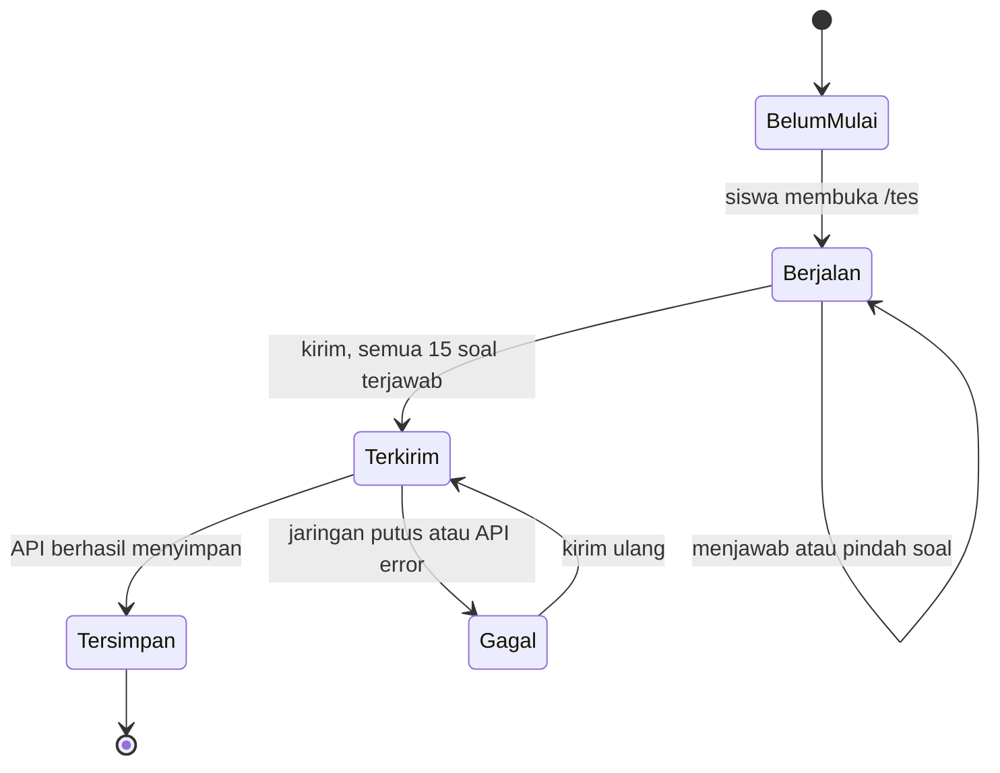

# 06 — Black-Box Test Design (P06)

Praktikum Quality Assurance · Aplikasi: **Lernova Web v0.1.0**
Kelompok: `Kelompok 4`
Anggota:
1. Muhammad Adzkia Madani / 23076012
2. Alim Kurniadi / 23076003
3. Muhammad Hariadi / 23076043
4. Zekia Rahmaddiano / 23076056

> Status dokumen: **desain**. Kolom *Actual* dan *Status* diisi setelah eksekusi (Test Executor). Seluruh 12 test case ada di `test-cases/05_Test_Cases.csv`. Tidak ada hasil yang diisi sebelum benar-benar dijalankan.

## 1. Ringkasan

Black-box = kita menguji dari luar: beri input, lalu bandingkan hasilnya dengan yang seharusnya. Ada 4 teknik, masing-masing 3 test case, total **12 test case**.

| Teknik | Artinya | Test case |
|---|---|---|
| Equivalence Partitioning (EP) | Kelompokkan input yang diperlakukan sama, uji satu wakil tiap kelompok | TC-04, TC-05, TC-06 |
| Boundary Value Analysis (BVA) | Uji tepat di bawah, pada, dan di atas batas | TC-01, TC-02, TC-03 |
| Decision Table | Daftar kombinasi kondisi dan hasil yang seharusnya | TC-07, TC-08, TC-09 |
| State Transition | Gambar status aplikasi, uji perpindahan yang boleh dan terlarang | TC-10, TC-11, TC-12 |

Test case negatif/invalid/terlarang: TC-01, 04, 05, 06, 07, 08, 09, 11, 12 (minimum tugas: 4).

**Test oracle** (patokan hasil benar) berasal dari requirement dan acceptance criteria P03, bukan dari perilaku aplikasi saat ini:
- Persentase gaya = jumlah jawaban kategori ÷ 15 × 100.
- Gaya dominan = persentase tertinggi. Jika seri, semua yang seri tampil (REQ-05).
- Data hasil valid: tiap persentase 0–100 dan jumlahnya 100 (REQ-09).

## 2. Equivalence Partitioning (3 test case)

| Kelompok input | Jenis | Wakil yang diuji | Test case |
|---|---|---|---|
| Skor tertinggi tunggal (mis. 9-3-3) | Valid | Jalur normal | (TC-10) |
| Skor tertinggi **seri** (mis. 6-6-3) | Valid, kasus khusus | 6-6-3 | **TC-04** |
| Data hasil dalam rentang 0–100 | Valid | Jalur normal | (TC-10) |
| Data hasil di luar rentang | Invalid | percentages.visual = 150 | **TC-05** |
| Tidak mengubah role | Valid | Aktivitas normal | (tidak diuji khusus) |
| Siswa mengubah role menjadi admin | Invalid/terlarang | role = admin | **TC-06** |

## 3. Boundary Value Analysis (3 test case)

Batas yang diuji: password minimal **6 karakter** (REQ-01).

| Nilai | Posisi | Expected | Test case |
|---|---|---|---|
| 5 karakter | Tepat di bawah batas | Ditolak | **TC-01** |
| 6 karakter | Tepat pada batas | Diterima (AC-01) | **TC-02** |
| 7 karakter | Tepat di atas batas | Diterima | **TC-03** |

Batas 14 vs 15 soal terjawab diuji di state transition (TC-11 dan TC-10). Batas persentase 0–100 diwakili TC-05 (nilai 150).

## 4. Decision Table (3 test case)

Yang dimodelkan: siapa boleh mengakses sumber daya yang dilindungi (halaman /tes, data hasil siswa, endpoint debug).

- **C1** = pengguna sudah login?
- **C2** = pengguna berhak (role sesuai atau pemilik data)?

| Aturan | C1 Login | C2 Berhak | Hasil seharusnya | Dieksekusi? |
|---|---|---|---|---|
| R1 | Ya | Ya | **Diizinkan** | Ya, sebagai bagian jalur normal TC-10 |
| R2 | Ya | Tidak | **Ditolak (403 / Akses Dikunci)** | Ya: **TC-07** (guru buka /tes) dan **TC-08** (siswa1 baca hasil siswa2) |
| R3 | Tidak | Ya | Ditolak (401) | **Tidak.** Tanpa login, aplikasi tidak bisa tahu siapa yang "berhak" |
| R4 | Tidak | Tidak | **Ditolak (401/403/404)** | Ya: **TC-09** (tanpa login buka endpoint debug) |

**Risiko R3 yang tidak diuji:** jika aplikasi memperlakukan "tanpa login tapi menyebut userId orang lain" secara berbeda, celahnya tidak tertangkap. R3 tetap dilewati karena secara logika sama dengan R4 (sama-sama tanpa identitas terverifikasi), dan menambah test case melebihi minimum. Risiko sisa: **rendah**.

## 5. State Transition (3 test case)

State tes siswa: Belum mulai, Berjalan, Terkirim, Tersimpan, Gagal.



| Perpindahan | Boleh? | Test case |
|---|---|---|
| Belum mulai → Berjalan → Terkirim → Tersimpan | Ya (normal) | **TC-10** |
| Berjalan → Terkirim saat baru 14 dari 15 soal terjawab | **Dilarang** | **TC-11** |
| Terkirim → Gagal (offline), lalu Gagal → Terkirim (kirim ulang) | Ya (pemulihan) | **TC-12** |

Tidak diuji: Belum mulai → Terkirim langsung (tidak ada tombolnya di UI) dan Tersimpan → Berjalan (tes ulang). Risiko sisa rendah.

## 6. Trade-off dan Residual Risk

| Yang tidak dilakukan | Alasan | Risiko sisa |
|---|---|---|
| Login password salah (AC-02) tidak punya test case sendiri | Batas 12 test case. Ditangani Firebase Auth, skor risiko rendah (R-08 = 6). | **Rendah.** Bisa ditambah 1 test case bila dosen meminta. |
| Registrasi langsung ke Firebase Auth dengan password 5 karakter (R-10) | Di luar 12 test case. TC-01 hanya lewat UI. | **Rendah.** Validasi klien bisa dilewati, dampaknya kecil. |
| Aturan R3 di decision table | Lihat bagian 4. | Rendah |
| R-06 dan R-07 tanpa test case khusus | Hanya diamati lewat Network di TC-04/TC-10 dan hasil /hasil di TC-10. | **Sedang.** Catat sebagai blind spot di P08. |
| Halaman admin dan analisis guru | Di luar scope (P04). | Dicatat sebagai blind spot. |
| Build (R-04) bukan test case | Dijalankan sebagai pra-uji **PRE-01**, bukti berupa log terminal. | — |
| Rules Firestore | Diuji di project uji kelompok dengan rules rancangan. Tidak berlaku untuk rules produksi. | Sedang |
| Data tidak dilihat langsung di Firebase Console | Bukti memakai API dan aplikasi (jumlah data sebelum dan sesudah, status HTTP, hasil login). | **Rendah.** Bukti tidak langsung. Dokumen mentah tidak diperiksa. |

## 7. Panduan Eksekusi (tanpa Firebase Console dan tanpa melihat database)

Semua pemeriksaan data lewat **aplikasi dan API**, memakai **Console browser** (DevTools, tab Console) dan tab Network. Tidak memakai Firebase Console dan tidak memakai `curl`. Nilai `API_KEY` dan `PROJECT_ID` dibaca dari `.env.local` (`NEXT_PUBLIC_FIREBASE_API_KEY` dan `NEXT_PUBLIC_FIREBASE_PROJECT_ID`).

**Cara pakai.** Buka `http://localhost:3000`, tekan **F12**, pilih tab **Console**. Jika Chrome menolak menempel, ketik `allow pasting` lalu Enter. Tempel blok di bawah satu per satu. Variabel dari blok 1 dipakai oleh blok berikutnya, selama tab tidak ditutup atau di-refresh.

**Blok 1. Login dan ambil UID** (TC-01, 02, 03, 06, serta mengambil UID untuk TC-05, 08). Ganti `ISI_...`, dan ganti email/password sesuai akun yang diuji:
```js
const API_KEY = "ISI_API_KEY";
const PROJECT_ID = "ISI_PROJECT_ID";
async function login(email, password) {
  const r = await fetch(`https://identitytoolkit.googleapis.com/v1/accounts:signInWithPassword?key=${API_KEY}`, {
    method: "POST", headers: {"Content-Type": "application/json"},
    body: JSON.stringify({email, password, returnSecureToken: true})
  });
  const d = await r.json();
  console.log(email, "UID:", d.localId, "error:", d.error && d.error.message);
  return d;
}
let s1 = await login("siswa@lernova.com", "<password uji>");
```
Untuk siswa2: `let s2 = await login("siswa2@lernova.test", "<password uji>");`. Jika email/password salah atau akun tidak ada, hasilnya `error` (dipakai di TC-01).

**Blok 2. Baca dokumen users** (TC-02, TC-06):
```js
const g = await fetch(`https://firestore.googleapis.com/v1/projects/${PROJECT_ID}/databases/(default)/documents/users/${s1.localId}`,
  {headers: {Authorization: "Bearer " + s1.idToken}});
console.log(g.status, await g.json());
```

**Blok 3. Coba ubah role** (TC-06), harapannya ditolak (403):
```js
const p = await fetch(`https://firestore.googleapis.com/v1/projects/${PROJECT_ID}/databases/(default)/documents/users/${s1.localId}?updateMask.fieldPaths=role`, {
  method: "PATCH",
  headers: {Authorization: "Bearer " + s1.idToken, "Content-Type": "application/json"},
  body: JSON.stringify({fields: {role: {stringValue: "admin"}}})
});
console.log(p.status, await p.json());
```

**Blok 4. Kirim data tidak valid** (TC-05), harapannya 400. Jalankan dari tab `localhost:3000`:
```js
const t = await fetch("/api/test-results", {
  method: "POST", headers: {"Content-Type": "application/json"},
  body: JSON.stringify({userId: s1.localId,
    counts: {visual: 15, auditori: 0, kinestetik: 0},
    percentages: {visual: 150, auditori: 0, kinestetik: 0},
    dominantStyle: "visual"})
});
console.log(t.status, await t.json());
```

**Blok 5. Hitung hasil tes** seorang siswa (TC-05, 08, 10, 11, 12), sebelum dan sesudah aksi. Ganti `s1` dengan `s2` bila perlu:
```js
const c = await (await fetch("/api/test-results?userId=" + s1.localId)).json();
console.log("jumlah hasil:", c.data.length);
```
Alternatif tanpa Console: buka `http://localhost:3000/api/test-results?userId=UID` di address bar (tanpa tanda `<` `>`) dan hitung item di `data`.

**Aturan lain:**
- Jalankan **PRE-01** dulu: `npm run build` dan `npm run lint`, simpan log ke `evidence/PRE-01_build_log.txt`. Jika build gagal, uji lain tetap bisa jalan dengan `npm run dev`.
- Opsi jawaban **diacak** tiap soal dimuat, jadi huruf A/B/C berubah-ubah. Pilih jawaban berdasarkan **teks opsi** memakai **Lampiran A** di bawah.
- Jumlah soal di project uji adalah **15** (dari respons `/api/seed`). Jika berbeda, hitung ulang item di `GET /api/seed` dan sesuaikan pola.
- Beri nama bukti `TC-XX_deskripsi.png` (atau `.txt` untuk respons API). Jangan perlihatkan password, API key, atau idToken di screenshot atau video. Sensor sebelum disimpan.
- Isi *Actual Result* dengan yang benar-benar terjadi. Jika beda dengan Expected, status **Fail** dan lanjut ke defect report (P07).
- Pemeriksaan lewat API adalah bukti tidak langsung. Catat sebagai keterbatasan di P08.

## Lampiran A. Kategori tiap opsi (15 soal) dan pola jawaban

Sumber: respons `GET /api/seed` pada project uji. Urutan soal di `/tes` mengikuti nomor di bawah. **V** = Visual, **A** = Auditori, **K** = Kinestetik. Cari teks opsi di layar, lalu klik opsi dengan kategori yang dibutuhkan.

| No | V (Visual) | A (Auditori) | K (Kinestetik) |
|---|---|---|---|
| 1 | Melihat gambar, diagram, atau infografis | Mendengarkan penjelasan guru atau teman | Mencoba langsung melalui praktik |
| 2 | Mengingat bentuk tulisan atau gambar | Mengingat suara atau percakapan | Mengingat aktivitas yang pernah dilakukan |
| 3 | Melihat peta atau panduan visual | Mendengarkan penjelasan langkah demi langkah | Mencoba langsung sambil mengikuti arahan |
| 4 | Membuat catatan berwarna atau mind map | Membaca materi dengan suara keras atau berdiskusi | Menggunakan simulasi atau praktik soal secara langsung |
| 5 | Slide, grafik, dan gambar yang ditampilkan | Penjelasan pembicara | Demonstrasi atau kegiatan interaktif |
| 6 | Membaca buku petunjuk atau melihat gambar panduan | Mendengarkan penjelasan dari penjual | Langsung mencoba cara penggunaannya |
| 7 | Melihat dan membaca berulang kali | Mengucapkan atau mendengarkan berulang kali | Menulis atau mempraktikkannya berulang kali |
| 8 | Membuat desain, diagram, atau presentasi visual | Menjelaskan ide dan berdiskusi dengan anggota tim | Mengatur dan melaksanakan pekerjaan secara langsung |
| 9 | Menonton video, film, atau membaca komik | Mendengarkan musik, podcast, atau radio | Berolahraga, bermain, atau melakukan aktivitas fisik |
| 10 | Menonton tutorial video atau melihat contoh | Mendengarkan instruksi dan bertanya kepada orang lain | Langsung mencoba dan belajar dari pengalaman sendiri |
| 11 | Mengingat tampilan bangunan atau peta | Mengingat petunjuk yang pernah didengar | Mengingat rute yang pernah saya lalui |
| 12 | Menggunakan gambar, tulisan, atau ilustrasi | Menjelaskannya secara lisan | Menunjukkan langsung cara melakukannya |
| 13 | Materi dengan banyak gambar dan presentasi | Sesi diskusi dan tanya jawab | Praktik langsung atau simulasi |
| 14 | Membayangkan adegan dan karakter dalam pikiran | Membayangkan suara atau dialog tokoh | Membayangkan diri saya ikut dalam kejadian tersebut |
| 15 | Pemandangan, warna, atau detail yang terlihat | Suara, percakapan, atau musik yang terdengar | Aktivitas dan perasaan yang saya alami saat itu |

**Pola jawaban yang dipakai** (mudah diikuti: satu kategori per blok nomor):

| Test case | Pola | Cara mengisi | Persentase yang diharapkan |
|---|---|---|---|
| TC-10 (dominan tunggal) | 9-3-3 | No. 1–9 pilih **V**, no. 10–12 pilih **A**, no. 13–15 pilih **K** | 60% / 20% / 20%, dominan Visual |
| TC-04 (seri) | 6-6-3 | No. 1–6 pilih **V**, no. 7–12 pilih **A**, no. 13–15 pilih **K** | 40% / 40% / 20%, Visual dan Auditori seri |
| TC-11 (belum lengkap) | 14 terjawab | Isi no. 1–14 mana saja, kosongkan no. 15, lalu coba Kirim | Kirim ditolak |
| TC-12 (jaringan putus) | 15 terjawab | Isi semua dengan pola bebas, mis. 9-3-3 | Lihat test case |
